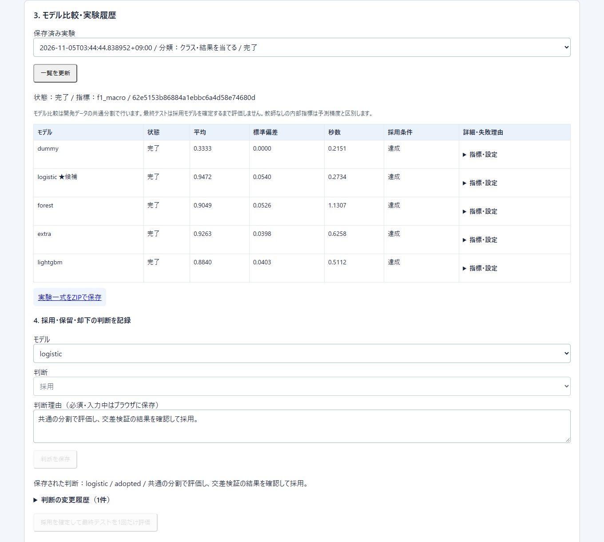
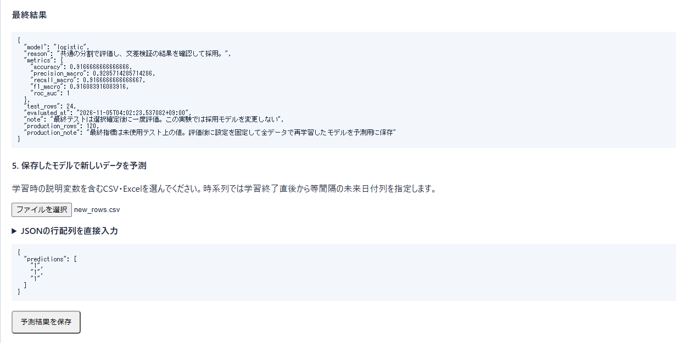

# sklearn-map-lab

[](https://github.com/rick0218gray-sketch/sklearn-map-lab/actions/workflows/ci.yml)

表データを取り込み、機械学習モデルを同じ分割で比較して、採用した理由と最終テストの結果を記録するローカルWebアプリです。Codexを活用して個人開発しました。

**English summary.** A local web app that profiles tabular data, compares machine-learning models on shared splits, and records the selection rationale before holdout evaluation. It is a personal project built with Codex. All figures below come from synthetic data.

| 観点 | 内容 |
| --- | --- |
| 作ったもの | データ診断、候補モデルの選定、交差検証での比較、採用理由の記録、最終テスト、新しい行の予測を1画面でつなぐアプリ（Python、FastAPI、React、scikit-learn、PyTorch） |
| 担当 | 個人開発。実装にCodexを活用しました。公開版は既存のローカルアプリからデータ取り込みと自動分析の機能を切り出した新規履歴で、手書きとCodex生成の内訳を行単位で示す記録はありません |
| 動作の確かめ方 | バックエンド30テスト（GitHub Actionsで毎回実行）、本番ビルド、実ブラウザでの操作、全モデル・全グラフの実行がすべて成功（[検証](#検証)） |
| 数値の範囲 | 掲載する数値はすべて合成データでの動作確認の値です。実データでの性能は評価していません |

## 動作画面

合成データ120行で5モデルを比較し、採用理由を保存した画面です。



採用を確定した後に最終テスト24行を評価し、別の合成データ3行を予測した画面です。



## できること

| 工程 | 実装 |
| --- | --- |
| データ診断 | CSV、TSV、Excel（.xlsx）、JSON、Parquetを取り込み、列の型・欠損・分布を表示 |
| 候補選定 | 分類、回帰、クラスタリング、異常検知、次元削減、等間隔時系列に応じて候補と除外理由を表示 |
| 比較 | 分類・回帰でDummy基準モデルを使い、共通の分割で交差検証。前処理は各foldの訓練部分で学習 |
| 判断の記録 | 採用・保留・却下と理由を実験に保存。分類・回帰・時系列の最終テストは採用確定後に評価し、評価後は採用モデルを変更不可 |
| 振り返り | 適用条件に合う診断グラフを生成。設定・結果をZIPに書き出し、対応モデルでは新しい行を予測 |

Reactが設定入力と結果表示を担当し、FastAPIがデータ取り込みと実験管理を担当します。学習・描画は別プロセスで実行し、実験記録はローカルの `analysis_data/` に保存します。

| ソース | 役割 |
| --- | --- |
| [frontend/src/AutoAnalysis.jsx](frontend/src/AutoAnalysis.jsx) | 取り込みから判断の保存までの操作画面 |
| [backend/analysis/api.py](backend/analysis/api.py) | データ取り込み、学習ワーカー、実験管理API |
| [backend/analysis/engine.py](backend/analysis/engine.py) | データ分割、モデル比較、採用後の最終評価 |
| [backend/analysis/graphs.py](backend/analysis/graphs.py) | 診断グラフの条件判定と描画 |

### ディレクトリ構成

```text
backend/
  main.py                  FastAPIアプリ。frontend/dist があれば静的配信
  analysis/                取り込み・分割・学習・評価・描画の本体
  tests/                   unittestのテスト（test_analysis.py、test_core.py）
  requirements-analysis.txt  実行に必要な依存パッケージ
  requirements-test.txt      テスト専用の追加依存（httpx）
frontend/                  Vite + Reactの画面（src/AutoAnalysis.jsx）
examples/make_demo.py      合成データのデモCSVを生成
verification/              READMEの値の再現と全モデル・全グラフの実行確認
docs/                      README掲載の画面画像
.github/workflows/ci.yml   GitHub Actions（バックエンドのテストとフロントエンドのビルド）
```

## セットアップ

Python 3.12とNode.js 24で検証しました。リポジトリのルートから実行します。依存パッケージにPyTorchなどを含むため、インストールには時間がかかります。

```sh
python -m venv .venv
# Windows PowerShell
.\.venv\Scripts\Activate.ps1
# macOS / Linux の場合は source .venv/bin/activate
python -m pip install -r backend/requirements-analysis.txt
npm --prefix frontend ci
npm --prefix frontend run build
python examples/make_demo.py examples/demo.csv
python -m uvicorn main:app --app-dir backend --host 127.0.0.1 --port 8000
```

`python -m venv` は環境によって `python3 -m venv` です。ブラウザで `http://127.0.0.1:8000/` を開き、`examples/demo.csv` を取り込みます。目的変数 `target` と分類は自動で候補に入ります。「おすすめで比較を実行」を選び、比較結果からモデルを選んで理由を保存し、最終テストを実行します。起動にAPIキーは不要です。保存先は環境変数 `SKLEARN_ANALYSIS_DIR` で指定できます。

## テストの実行

テストと再現スクリプトには、上の依存に加えてテスト用の依存が必要です。

```sh
python -m pip install -r backend/requirements-test.txt
cd backend
python -m unittest discover -s tests -v
cd ..
python verification/reproduce_demo.py
python verification/check_analysis.py
```

`check_analysis.py` は全モデル・全グラフを実行するため数分かかります。結果は `verification/analysis_check.json`（Git管理外）に書き出します。

GitHub Actions（[.github/workflows/ci.yml](.github/workflows/ci.yml)）は、pushとpull requestのたびにUbuntu・Python 3.12でバックエンドのテストを、Node.js 24で `npm ci` と `npm run build` を実行します。

## 検証

2026-11-05に、公開中のソースをWindows 11の新しい環境へ取得し、READMEの手順で再実行しました。環境はPython 3.12.13、Node.js 24.19、scikit-learn 1.9.1、pandas 3.1.1、FastAPI 0.162.0です。

| 確認 | 実行方法 | 結果 |
| --- | --- | --- |
| バックエンド | `backend/` で `python -m unittest discover -s tests -v` | 30テストすべて通過（Linux・GitHub Actions。Windowsでは `test_core.py` 追加前の14テストで確認） |
| フロントエンド | `npm --prefix frontend run build` | 本番ビルド成功 |
| 合成データの再現 | `python verification/reproduce_demo.py` | 下表の値を再現 |
| 実ブラウザ | セットアップ後に画面を操作 | 120行の取り込み、5モデル比較、判断の保存、最終テスト24行、3行の予測を確認 |
| 全モデル・全グラフ | `python verification/check_analysis.py` | 6タスクの合成データで65のタスク・モデルの組合せがすべて完了し、95種類のグラフをすべて描画 |

テストと再現スクリプトの実行方法は[テストの実行](#テストの実行)を参照してください。テストはCSV（CP932）・Excelの取り込み、欠測や分割条件の拒否、fold内の前処理、最終テストの二重評価防止、保存失敗からの復旧、時系列、2D CNN、取り込みからZIP出力までの通し動作をカバーします。

バックエンドのテストのうち `backend/tests/test_core.py` の16件は、ランダム・グループ・時間順の各分割で最終テストと交差検証が重ならないこと、指標の計算、主指標の検証、停止時の状態、予測時の欠測の扱いを確認します。Linux（Python 3.12.3、Node.js 24.22）で、セットアップ手順（サーバー起動とAPIからの取り込みまで。画面操作は除く）、30テスト、本番ビルド、`reproduce_demo.py`（下表と同じ値）、`check_analysis.py`（65組合せ・95グラフ）がすべて成功することを確認しました。

| 合成データ120行の結果 | マクロF1 |
| --- | --- |
| Dummy（3分割交差検証の平均） | 0.3333 |
| Random Forest（同） | 0.9049 |
| Extra Trees（同） | 0.9263 |
| LightGBM（同） | 0.8840 |
| ロジスティック回帰（同） | 0.9472 |
| ロジスティック回帰（最終テスト24行） | 0.9161 |

これらは `make_classification` で生成した合成データに限った動作確認の値で、モデルの実力や実データでの性能を示すものではありません。

## 制約

ローカルの単一ユーザー向けです。外部公開サーバーに必要な認証やユーザー分離は備えていません。実験ZIPには取り込んだデータが含まれます。比較スコアはデータと分割条件に依存します。予測時に使えない列は利用者が除外し、グループや時系列の構造に応じて分割条件を設定します。依存パッケージのバージョンは固定していないため、将来の更新で値が変わる可能性があります。今後の課題は、実データでの比較と分割条件ごとの検証範囲を増やすことです。
